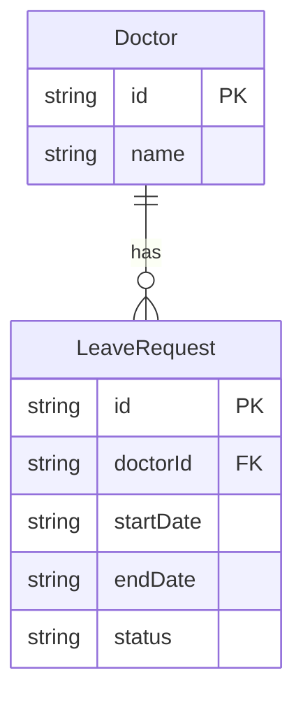

# Functional Specification — u1-skeleton

## Sources

- [desc] Initial description: Read ./vision.md and build what it describes
- [scope] Workflow-selected scope: workshop
- requirements.md (FR1, NFR1–NFR3)
- components.md (Auth, InMemoryStore)
- contract-summary.md (C1, C2)
- stories.md (US1.1: AC1.1.1–AC1.1.5)

## Assumptions & Open Questions

None.

---

## Overview

The walking skeleton (u1-skeleton) creates every shared file the feature units depend on. It does not implement business logic — it proves the pipeline: the server starts, routes are mounted, auth is enforced, and the store is accessible. Feature units add routes inside their own folders only.

---

## ER Diagram (derived from entities.md)



---

## Workflows

### W1 — Server Startup

1. `src/server.ts` imports the app factory from `src/app.ts`.
2. The app factory creates an Express 5 application.
3. It mounts the doctors router at `/doctors` (imported from `src/features/doctors/`).
4. It mounts the leave router at `/leave` (imported from `src/features/leave/`).
5. `src/server.ts` calls `app.listen(3000, "127.0.0.1")` (BR2.1).
6. The server is ready to accept requests.

Note: At skeleton delivery, both feature routers are empty (no routes registered). The test suite verifies the server starts and auth is enforced; 404 on an unregistered route is acceptable at this stage.

### W2 — Auth Middleware Execution (every request)

Every request passes through the auth middleware before reaching any route handler.

```
Request arrives
  │
  ▼
[Check X-User-Id header]
  │ missing/empty ──► 401 { error: "Unauthorized" }  (BR1.1)
  │ present
  ▼
[Check X-User-Role header]
  │ missing/empty ──► 401 { error: "Unauthorized" }  (BR1.2)
  │ present
  ▼
[Validate role value]
  │ not "manager" | "doctor" ──► 403 { error: "Forbidden" }  (BR1.3)
  │ valid
  ▼
[Attach { userId, role } to request context]
  │
  ▼
next() → route handler
```

### W3 — Role Guard (requireRole middleware)

Used by individual routes that require a specific role.

```
Request context has { userId, role }
  │
  ▼
[role === requiredRole?]
  │ no ──► 403 { error: "Forbidden" }  (BR1.4)
  │ yes
  ▼
next() → route handler
```

### W4 — Store Access Pattern

Feature units use the shared store; they never connect to external services (BR2.2).

```
Feature route handler
  │
  ▼
[import { store } from "../../shared/store"]
  │
  ▼
[Read: store.doctors | store.leaveRequests]
[Write: store.doctors.push(...) | store.leaveRequests.push(...) | mutate status]
  │
  ▼
Return response
```

Test setup:
```
beforeEach: store.reset()   ← clears all collections
```

---

## State Machines

### LeaveRequest Status Transitions

```
           submit (doctor)
               │
               ▼
           [pending]
           /        \
  approve            reject
 (manager)          (manager)
     │                  │
     ▼                  ▼
 [approved]        [rejected]
     │                  │
      \                /
       reject/approve  (re-actioning allowed — manager can move from any state to any state)
```

Re-actioning rule: A manager may approve a rejected request or reject an approved request (FR3.4 / AC3.3.2, AC3.4.2). There is no terminal state.

---

## Rules Summary (derived from rules.md)

| ID | Statement |
|---|---|
| BR1.1 | Missing X-User-Id → 401 |
| BR1.2 | Missing X-User-Role → 401 |
| BR1.3 | Unknown role value → 403 |
| BR1.4 | Wrong role for endpoint → 403 |
| BR2.1 | Server listens on 127.0.0.1:3000 only |
| BR2.2 | All data in shared in-memory store; no external persistence |

---

## Story Coverage

US1.1 is implemented by this unit. All 5 acceptance criteria are covered by the auth middleware:

| AC | Covered by |
|---|---|
| AC1.1.1 (missing X-User-Id → 401) | BR1.1 / W2 |
| AC1.1.2 (missing X-User-Role → 401) | BR1.2 / W2 |
| AC1.1.3 (doctor on manager endpoint → 403) | BR1.4 / W3 |
| AC1.1.4 (manager on doctor endpoint → 403) | BR1.4 / W3 |
| AC1.1.5 (unknown role → 403) | BR1.3 / W2 |
