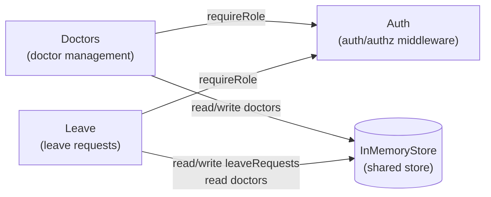

# Component Catalogue — Clinic Leave API

## Sources

- [desc] Initial description: Read ./vision.md and build what it describes
- [scope] Workflow-selected scope: workshop
- requirements.md (FR1–FR3, NFR1–NFR3)
- stories.md (US1–US3)
- project.md (ALWAYS read another feature's data through src/shared/store.ts)

## Assumptions & Open Questions

- Auth middleware is applied per-router (each feature router imports `requireRole` from Auth); not mounted globally at the app level, so the per-route role requirement is explicit.
- The shared in-memory store (src/shared/store.ts) is infrastructure code, not a domain component: it has no business logic, owns no domain entities, and is an external dependency of Doctors and Leave.

---

```yaml
components:
  - name: Auth
    summary: HTTP request authentication and role-based authorization middleware
    behaviour: >
      Validates X-User-Id and X-User-Role headers on every incoming request.
      Returns HTTP 401 when either header is absent.
      Returns HTTP 403 when the role does not match the route's required role.
      Exports a requireRole(role) middleware factory consumed by the feature routers.
      Valid roles are "manager" and "doctor"; any other value is rejected with HTTP 403.
    responsibilities:
      - Validate presence of X-User-Id and X-User-Role headers
      - Enforce per-route role requirements via requireRole middleware factory
      - Export typed request augmentation so downstream handlers can read userId and userRole
    depends_on: []
    dependents:
      - component: Doctors
        interaction: Doctors router applies requireRole middleware on manager-only and authenticated routes
      - component: Leave
        interaction: Leave router applies requireRole middleware on doctor-only and manager-only routes
    external_dependencies: []
    entities: []

  - name: Doctors
    summary: Doctor record management — create and list clinic doctors
    behaviour: >
      Accepts POST /doctors (manager-only): creates a doctor with the provided id and name.
      Enforces unique id; rejects duplicates with HTTP 409.
      Accepts GET /doctors (any authenticated user): returns all doctors in the store.
      Doctor records are immutable after creation; no update or delete operations.
      Validates request body with zod; returns HTTP 400 on schema violations.
      Delegates all persistence to the shared in-memory store.
    responsibilities:
      - Create a doctor record (id, name) on behalf of a manager
      - Enforce doctor id uniqueness
      - List all registered doctors for any authenticated user
    depends_on:
      - component: Auth
        interaction: Applies requireRole middleware to enforce authentication and manager-only access on POST
        style: sync
    dependents: []
    external_dependencies:
      - name: InMemoryStore
        kind: other
        purpose: Persists and retrieves Doctor records; provides reset() and seed() for test isolation
    entities:
      - name: Doctor
        identifier: id
        attributes: [id, name]
        references: []

  - name: Leave
    summary: Leave request lifecycle — submit, action, and list requests
    behaviour: >
      Accepts POST /leave (doctor-only): submits a leave request with doctorId, startDate, endDate.
      Validates that endDate >= startDate; returns HTTP 400 on invalid date range.
      Validates that doctorId exists in the doctors collection; returns HTTP 404 if absent.
      Assigns a UUID id and sets status to "pending" on creation.
      Accepts PATCH /leave/:id (manager-only): updates status to "approved" or "rejected".
      Manager can re-action any request regardless of current status.
      Returns HTTP 404 when the request id does not exist.
      Returns HTTP 400 when the submitted status value is not "approved" or "rejected".
      Accepts GET /leave (doctor: own requests filtered by X-User-Id; manager: all requests).
      Validates all request bodies with zod; returns HTTP 400 on schema violations.
      Reads doctor existence directly from the shared store — never imports from the Doctors component.
    responsibilities:
      - Submit a leave request and assign UUID id and pending status
      - Validate date range (endDate >= startDate)
      - Verify doctorId existence via shared store
      - Approve or reject any leave request as a manager
      - Validate status update value (approved or rejected only)
      - List leave requests filtered by role (own vs. all)
    depends_on:
      - component: Auth
        interaction: Applies requireRole middleware to enforce doctor-only (POST) and manager-only (PATCH) access
        style: sync
    dependents: []
    external_dependencies:
      - name: InMemoryStore
        kind: other
        purpose: Persists and retrieves LeaveRequest records and reads Doctor records for existence checks; provides reset() and seed() for test isolation
    entities:
      - name: LeaveRequest
        identifier: id
        attributes: [id, doctorId, startDate, endDate, status]
        references:
          - entity: Doctor
            owned_by: Doctors
            relationship: each LeaveRequest belongs to one Doctor (by doctorId)
```

---

## Component Diagram



---

## Component Summary

| Component | Purpose | Depends On | Dependents | Entities Owned |
|---|---|---|---|---|
| Auth | Authentication and role-based authorization middleware | — | Doctors, Leave | — |
| Doctors | Doctor record management (create, list) | Auth | — | Doctor |
| Leave | Leave request lifecycle (submit, action, list) | Auth | — | LeaveRequest |

---

## Entity Ownership

| Entity | Owning Component | Identifier | Attributes | References |
|---|---|---|---|---|
| Doctor | Doctors | id | id, name | — |
| LeaveRequest | Leave | id | id, doctorId, startDate, endDate, status | Doctor (owned by Doctors) |

---

## External Dependencies

| Component | Dependency | Kind | Purpose |
|---|---|---|---|
| Doctors | InMemoryStore | other | Persists Doctor records; reset/seed for test isolation |
| Leave | InMemoryStore | other | Persists LeaveRequest records; reads Doctor records for existence checks; reset/seed for test isolation |

---

## Rationale

| Component | Why a Separate Building Block |
|---|---|
| Auth | Distinct cross-cutting concern with its own lifecycle (header validation logic independent of domain rules). A change to the auth contract (e.g., switching from headers to JWTs) should not touch Doctors or Leave. |
| Doctors | Distinct data ownership (Doctor entity), distinct change rate, and a self-contained feature Unit in Construction. No business rules overlap with Leave. |
| Leave | Distinct data ownership (LeaveRequest entity), distinct change rate, and a self-contained feature Unit. Reads Doctor existence via the shared store — not via a Doctors import — to maintain feature isolation. |

**Alternatives Rejected:** A single `Features` component was considered; rejected because it would merge two distinct bounded contexts (doctor management and leave management), coupling their change rates and making independent parallel development impossible. See ADR-001.
