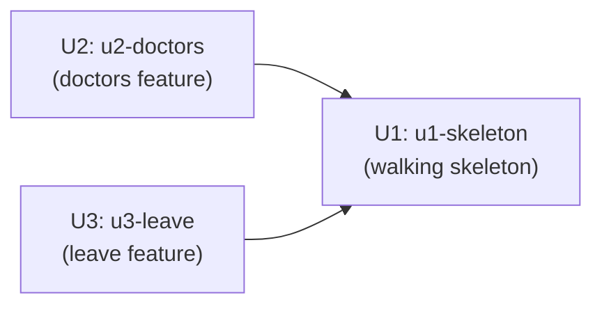

# Unit Dependency DAG — Clinic Leave API

## Sources

- [desc] Initial description: Read ./vision.md and build what it describes
- [scope] Workflow-selected scope: workshop
- components.md (Auth, Doctors, Leave)
- project.md (skeleton first; feature Units own their folder; only shared store for cross-feature reads)

## Assumptions & Open Questions

None.

---

## Dependency DAG

```yaml
units:
  - name: u1-skeleton
    kind: service
    depends_on: []
  - name: u2-doctors
    kind: service
    depends_on: [u1-skeleton]
  - name: u3-leave
    kind: service
    depends_on: [u1-skeleton]
```

---

## Diagram



---

## Integration Points

| Edge | What crosses the boundary |
|---|---|
| u2-doctors → u1-skeleton | `src/shared/store.ts` (doctors collection), `src/shared/auth.ts` (requireRole), `src/shared/errors.ts`, Express app router slot in `src/app.ts` |
| u3-leave → u1-skeleton | `src/shared/store.ts` (doctors + leaveRequests collections), `src/shared/auth.ts` (requireRole), `src/shared/errors.ts`, Express app router slot in `src/app.ts` |

---

## Parallel Development Opportunities

U2 (u2-doctors) and U3 (u3-leave) have no dependency between them. Once U1 is merged to `main`, both developers can branch from `main` and build their feature unit simultaneously in separate clones. Neither unit edits the other's files.

---

## Walking Skeleton (U1 as the Integrated Slice)

U1 (u1-skeleton) is the skeleton-on integrated slice. It creates a running Express server with both feature routers mounted as empty routers and verifies the end-to-end path (request → auth middleware → empty router → response) with tests. U2 and U3 are not required for U1 to start, respond, or pass tests — U1 runs independently before any feature unit lands.

---

## Topological Notes

This DAG is cycle-free. The only valid topological ordering is: U1 first, then U2 and U3 in any order (or simultaneously). There is no single critical path within the parallel tier — U2 and U3 are equal in precedence. Delivery Planning will decide which of the two parallel units to sequence first based on economic priorities.
